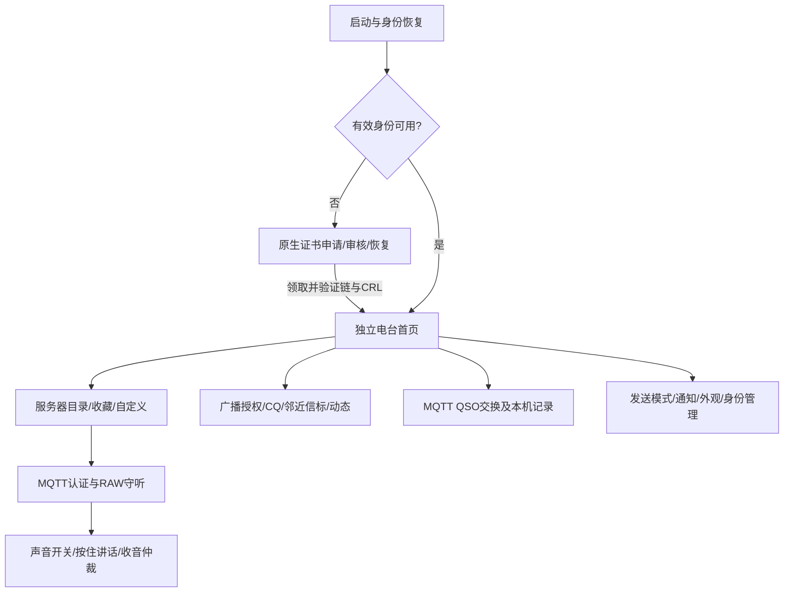

# RF Link iOS 调研与 Passport 设计入口

本轮先完成当前实现梳理，供下一步共同设计 AI Passport 版本；不代表固件需求冻结、架构获批准或正式 RF Link 已在设备上运行。

## 调研基线与证据边界

- iOS 源码：`/Volumes/DataVolume/Development/projects/FMO-Link`，分支 `beta`，提交 `97de094e141cac7dcf5703e6b60d39a40fe886dd`，调研前后工作树应保持干净。
- 本文档组中的 `FMOLink/...`、`FMOLinkTests/...`、`docs/adr/...` 均相对于上述 iOS 仓库；省略 `FMOLink/` 的 `App/...`、`Features/...` 相对于其应用源码目录，只有文件名时指该树内同名唯一文件。`scripts/...` 相对于仓库根。行号绑定这一提交，Passport 文件路径另行明确标注。
- 已读取 iOS 的 AGENTS、项目简报、产品/技术约束、相关 ADR/模块、实际入口/模型/协议与关键测试。执行其只读文档新鲜度检查，提示 39 份历史文档超过30天；没有修改源仓库，没有运行 iOS 构建/测试/模拟器或连接生产服务。
- “已接入”表示当前入口存在实际实现，不等于本轮验证所有功能运行正常。测试源码只作为行为依据，不借用历史 PASS 为本轮验收结果。
- 已有 BLE 实验真实验证的是：公开测试私钥下的浏览器代签、设备Ed25519验签、单公钥绑定和异常恢复；不是正式证书申请、SAS/APRS互通或完整电台固件验收。见[实验验收](../../development/ble-signer-lab-validation-2026-10-31.md)。

## 阅读顺序

1. [功能与业务流程](features-and-flows.md)：当前用户能做什么、进入条件、成功/失败路径，及遗留代码排除。
2. [协议、身份与数据边界](protocols-and-identity.md)：MQTT/RAW/codec、证书/CBOR/SAS/APRS、QSO与资料交换。
3. [Passport 设计输入与待决策项](passport-design-inputs.md)：已确认原则、硬件差异、两种架构候选、资源风险及下一步需要确认的范围。

## 当前产品的真实结构

实际入口是 `FMOLink/FMOcApp.swift:16` → `App/LinkRuntime.swift:4` → `AppComposition.makeLinkModels()` → `Features/Voice/UI/LinkRootView.swift`。旧 `makeModels()`、`ContentView` 和盒子模块仍有源码，但不是新固件功能清单。

## 资料地图与文档漂移

| 资料 | 用途 | 本轮结论 |
| --- | --- | --- |
| `AGENTS.md`、`docs/project-brief.md` | 当前边界与近期演进 | 简报包含大量历史，入口和新修订须与代码对照 |
| `docs/spec/product-spec.md`、`technical-spec.md` | 总需求及约束 | 保留盒子发现/GEO/远控/ADIF等旧产品；不能整份照搬 |
| ADR-0011/0012/0013 | 公开直连协议、独立终端、单活跃身份 | 当前产品基本方向；不是原样可复用的小屏UI |
| ADR-0015 | 声音开启时后台守听/有界重连 | iOS运行策略，不能替代固件电源设计 |
| ADR-0016 | V4 APRS会话可发本机广播 | 取代“永久pass -1只读”的旧约束 |
| ADR-0017 与 ADR-0018 | 签名清单及正式申请信任 | 正式域走0018/ProductionTrustManifestStore，不能沿用旧清单自行增根或过期继续授权 |
| ADR-0019/0020/0021 | MQTT QSO、TELE/RIG、自定义匿名Broker | 都有当前实现，不能按早期Direct Voice首版范围忽略 |
| ADR-0022 | iOS18兼容 | 与Passport无直接UI/运行时复用关系 |
| `docs/architecture/modules/link-terminal.md` | 独立电台模块 | 原生申请追加章节有效；早期复制申请包/手工导入描述已落后 |
| `docs/architecture/modules/direct-voice.md` | 语音会话 | 旧“无退避重连/CRL刷新”与实际代码冲突；后文已补修订 |
| `docs/architecture/modules/aprs.md` | 网络/广播/信任流程 | 混有旧全网地图与消息入口；当前首页没有开放全部入口 |
| `docs/references/fmo-aprs-v4/` | 帧、签名、广播与APRS-IS说明 | 有早期行号、样例和观测背景，协议细节需以当前编解码和测试复核 |
| 当前Swift源码及对应测试 | 实际行为与异常边界 | 本轮调研的逐项证据；未重新执行测试 |

已确认的具体漂移：

- 产品旧文档写多Tab、跨页PTT/迷你条、仅HTML原型；当前是原生单首页与Sheet。
- 旧身份流程写生成申请包→外部网页→粘贴导入；当前是原生上传执照图片→人工审核轮询→自动领取。
- 旧设置文档写不做通知；当前有CQ推送设置及APNs登记。
- ADIF导出、标准APRS消息、盒子远控等有遗留代码，当前入口不提供；不得列作本轮迁移必做功能。
- 语音包没有通用跨包序号，CRC也不认证讲话者；不能从字段名称或旧描述推导出端到端身份保证。

## 下一步交付边界

先共同确认架构分工和首版用户流程，再编写产品规格、交互设计与架构决定。当前仅在[设计输入](passport-design-inputs.md)给出候选与验证问题，未建立新的已接受ADR，未开始RF Link产品固件实现，也没有因此获得产品固件写入或发布授权。

## 当前产品方向更新

2026-10-31用户完成Web音频试听后，选择纯BLE手咪、使用App身份和固定PCM首版。[ADR0003](../../adr/0003-rf-link-ble-handmic.md)替代此前独立联网方向；当前协议与App交付入口见[手咪对接包](../../spec/rf-link-handmic/README.md)。本目录其他独立联网分析保留为历史调研，不作为首版当前要求。
