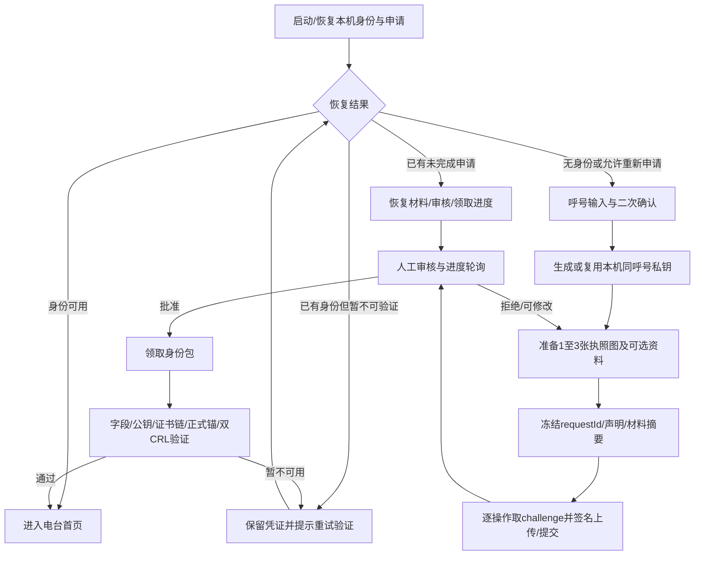
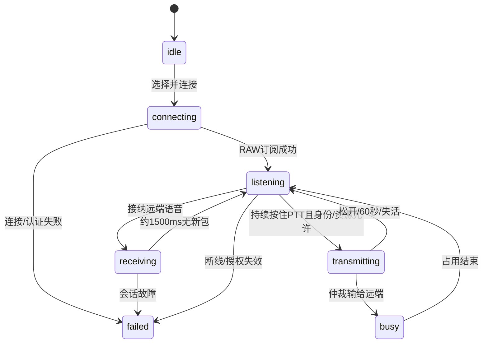

# RF Link iOS 功能与业务流程

来源及版本见[调研入口](README.md)。下表区分“当前入口已接入”与“源码存在但未接入”；不以旧伴侣App的能力代替当前RF Link。

## 功能清单

| 功能域 | 当前可见能力与业务条件 | 主要源码证据 |
| --- | --- | --- |
| 首页 | 单竖屏滚动首页：通联主卡、条件地图、最多六条动态；底部选服/声音/PTT；更多菜单进入功能Sheet | `Features/Voice/UI/LinkRootView.swift:194,521,915` |
| 身份申请 | 呼号确认、1–3张执照图、可选联系/设备信息、提交/审核/修改/重试/自动领取 | `LinkEnrollmentView.swift:88,253,316` |
| 身份恢复/删除 | 启动恢复；链/双CRL不确定时阻塞并可重试；确认+生物认证后删除本机身份，QSO保留 | `Identity/LocalIdentityDeletion.swift:46`、`DirectVoiceSessionModel.swift:339` |
| 服务器 | 已验证目录与有效签名清单、自定义、收藏、搜索、当前配置、切换 | `DirectVoiceViews.swift:218,316,361` |
| 自定义服务器 | 地址/端口/TLS/认证方式；SAS目标身份；粘贴STATION仅填表；保存不自动连接 | `CustomServerEditorView.swift:20`、`DirectVoiceSessionModel.swift:443` |
| 语音接收 | 守听、讲话者、占线/切流、声音开关、Opus与RADPCM接收 | `Session/DirectVoiceSession.swift:338` |
| 语音发送 | 前台持续按住PTT、松开/失活/故障停发、60秒上限；发送模式流畅/高保真 | `DirectVoiceSessionModel.swift:490`、`VoiceTransmitMode.swift:3` |
| APRS广播 | 默认关闭；上线、手动CQ、手动邻近信标；网格/精确位置、SSID、位置更新、频率等配置 | `APRS/APRSBroadcastSettings.swift:18`、`APRSBroadcastView.swift:24` |
| 网络动态 | 语音活动、CQ/OMCQ、ONLINE、BEACON与本机发送；按信任与服务器资格过滤 | `LinkFeed.swift:76`、`APRS/FMOV4FeedAdmission.swift:5` |
| 附近提示 | APRS直频信标80km；语音对象附近提示另有50/55km及资料新鲜度规则 | `LinkFeed.swift:138`、`LinkNearbyStationPolicy.swift:64` |
| QSO | 根据真实话轮自动请求/确认，菜单手动兜底；查询、新增、编辑手动记录、删除、保存重试 | `QSO/FMOQSOQualification.swift:24`、`LinkQSOListView.swift:17` |
| 电台资料 | 独立共享开关；TELE频率公告与PTT时RIG；不等于APRS广播授权 | `Session/FMOStationExchange.swift:58` |
| 推送 | CQ关闭/全部，系统权限与APNs登记；“老友”尚禁用 | `LinkRootView.swift:233,1142`、`Features/Push/PushRegistrationCoordinator.swift:67` |
| 设置 | 呼号/删除身份、外观、发送模式、权限、版本/联系/隐私 | `LinkRootView.swift:1142` |

未从当前首页接入：旧盒子发现与诊断、GEO写坐标、盒子本地PCM、盒子QSO同步、旧ADIF导出、通用APRS短消息与远控、完整全网地图/目录、多身份切换、管理员工具。代码保留不代表要为Passport继续交付。当前QSO记录入口是 `Features/QSO/LinkQSOListView.swift`，ADIF导出在旧 `QsoViews.swift:48`。

## 1. 首次启用、申请和恢复



- 无可用身份时强制全高认证页，不能滑走回到无证书首页；页面依恢复状态展示重试、申请进度或呼号表单，不是所有失败都从头申请（`LinkRootView.swift:87`；`LinkEnrollmentView.swift:48,144,351`；`DirectVoiceSessionModel.swift:110`）。
- 图片上传、提交、轮询、领取分别需要持钥证明；不能把一次签名当作整个申请永久授权。轮询退避/重试见[协议文档](protocols-and-identity.md)。
- 打开材料页、确认重启和App进入后台会暂停相应轮询，不能把“手机有网络”当成轮询永远活跃。
- “重新开始”只清本机冻结申请、材料与恢复入口，保留同呼号私钥/已签证书/QSO，不撤回服务端申请。
- “删除本机身份”是另一条流程：确认及生物认证→尽力关闭推送→停止会话→删除本机密钥/身份/申请→保留QSO→回认证页；不是远端吊销证书。
- 无当前证书、证书失效和CRL暂不可确认是不同状态，应分别提示，不得统一显示成普通网络错误。

源码：`LinkEnrollmentView.swift:144,253,316,351`；`Enrollment/NativeEnrollmentModel.swift:44,104,117`；`Identity/LocalIdentityDeletion.swift:46`。

## 2. 选服与连接

```text
启动恢复身份及当前服务器配置
→ 有可用身份/已存Profile：自动连接上次服务器
  无Profile：用户选择目录/收藏/自定义条目
  已有失败状态：用户可在首页点击“连接电台”重试
→ 切换已有会话时，停止旧会话并取消旧任务
→ 校验本机身份、目标配置与授权
→ SAS：为此次CONNECT签proof；匿名：不带用户名/密码
→ MQTT连接成功
→ RAW订阅收到SUBACK
→ 进入守听
→ 独立启动QSO及TELE/RIG，失败不拖垮RAW
```

- 启动自动连接上次服务器属于内置行为，不是要求用户每次开机人工选服；源码为 `LinkRootView.swift:163,292,896`。
- 自定义编辑的“保存”只保存；点行才切换连接。
- 普通目录点击即切换；动态CQ跳服要先确认“切过去”，因为会离开当前通联。
- 当前服务器的勾选表示保存配置匹配，不保证当前在线。
- 匿名模式须用户显式选择，SAS失败不自动降级；本机身份仍要有效。
- 已验证服务器目录与有效签名清单提供资料，收藏独立；离线缓存及最近广播时间不能证明当前可连接。
- 只有自有/互信服务器进入普通语音选择资格；自定义是另一路显式用户配置，不因粘贴STATION自动获得可信身份。

源码：`DirectVoiceViews.swift:218,316,459`；`LinkRootView.swift:64,649`；`DirectVoiceSession.swift:105`；`Authentication/DirectVoiceAuthentication.swift:348`。

## 3. 守听与PTT



- 声音默认关并持久保存；静音仍接收并解码，用户只是不听播放。
- 首次麦克风授权通过后要求重新按压，不自动发射；接收/忙时按压提示占线。
- PTT按下、连续音频帧、松开本身都不调用Ed25519私钥签名；SAS会话及授权刷新是另一条链。
- 每轮固定发送codec。首帧立即发，后续聚合；结束不足一帧补零，并尝试尾包flush；中断不能简单理解为全部尾音被丢弃。
- 新页面Sheet打开会结束发射，接收连接继续；切服、权限问题、系统打断、旧耳机断开等按各自规则停发/释放音频。
- 声音开启时iOS允许后台守听与有界重连；发射仅前台。Passport必须另定息屏/休眠/掉网策略，不能照搬ScenePhase。

源码：`Session/DirectVoiceSession.swift:219,250,277,338,404`；`DirectVoiceSessionModel.swift:86,490,579`。

## 4. 广播、CQ、信标与位置

| 操作 | 前置条件与行为 |
| --- | --- |
| 开启对外广播 | 默认关；位置授权/定位失败会提示并退回关闭；改变APRS登录权限需重连 |
| ONLINE | 连接/切服后，在身份、广播开关、上线开关、位置、目标资格满足时发送一次，不是周期保活 |
| CQ | 手动操作；菜单还要求当前已连接及服务器允许公告，缺位置/证书/网络需明确失败 |
| BEACON | 手动操作；广播开启且填写有效真实频率；设备/天线/高度按用户输入，不伪造RF参数 |
| 守听文本状态 | 无签名APFMO1展示文字；不可用来授权或验证身份 |
| 共享电台资料 | 独立于APRS广播；TELE/RIG由频率及完整资料控制，不自动视为已许可公开坐标 |

默认广播位置取六位网格中心；精确模式的线路位置仍是度分两位小数，不等于任意精度GPS。SSID默认16，App范围16–30与旧硬件错开；这是产品约定，不是不可更改的协议硬限制。完整APRS登录地址≤9字节，长呼号可使两位SSID不可用。

本机位置目前由手机前台定位更新，Passport硬件规格没有GNSS。位置可以由手机供应，但来源、年龄、失联后保留/停止广播及隐私授权均需设计，不能默认“保持最后位置就永远广播”。

两种附近语义：

- APRS BEACON仅显示可算距离且80km内的直频提示。
- 当前语音对象的附近资料使用当前Broker/UID/完整呼号绑定、五分钟新鲜RIG及本机精确位置；50km进入、55km退出。历史坐标缓存不能替代这个资格，不自动调频或自动切服。

源码：`APRS/APRSBroadcastSettings.swift:18,34,59,124,151`；`APRSBroadcastView.swift:140`；`LinkFeed.swift:138`；`LinkNearbyStationPolicy.swift:64`。

## 5. 首页动态与地图

动态合并语音活动、CQ/OMCQ、ONLINE、BEACON及本机成功发送，倒序最多六条；自身网络回流按呼号+SSID去重。VOCAL、服务器目录和公告不进入当前首页动态。CQ可确认切服，信标开详情，讲话条目仅在附近资格满足时可打开资料。

地图围绕当前/最近讲话人：优先新鲜APRS，其次RIG网格中心，再历史缓存；本机讲话用本机位置。无坐标则不绘制，不把历史/网格位置描述为实时精确坐标。

网络输入先经证书/CRL/签名检查，再经首页范围准入；拥有一张RF Link用户证书，不足以让任意服务器的活动进入互信动态。服务器目录以UID与证书指纹共同校对。

源码：`LinkFeed.swift:76,174`；`LinkRootView.swift:649,991`；`APRS/FMOV4FeedAdmission.swift:5`。

## 6. QSO与通知

QSO自动触发依赖有效通话轮次和双方资格，不是每次PTT落一条记录；菜单允许有条件重发/确认。60秒请求期限、话轮资格、重复抑制、幂等回执与保存失败重试见[协议文档](protocols-and-identity.md)。

当前记录页可查找、手工新增/编辑、删除，交换记录展示UID、网格、中继和祝语等。祝语≤63 UTF-8字节；未保存记录只重试保存，不自动重发网络请求。当前入口没有ADIF导出。

CQ通知由手机APNs承接；关闭/全部已接入，“老友”未开放。通知权限被拒绝时提示“设置开着但收不到”，不是私自改变用户选择。Passport自身没有APNs能力，这项应在后续设计中明确手机归属及设备是否需要另有本地提示。
