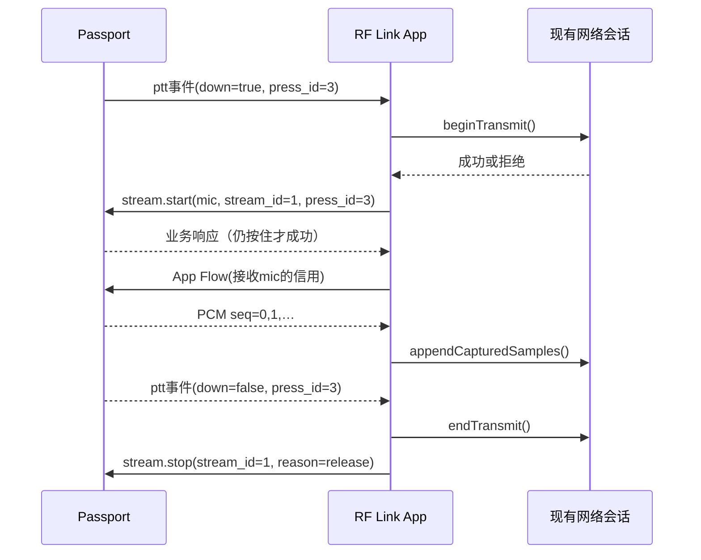

# RF Link 手咪 BLE 协议 1.0（定稿）

> 历史合同/试验记录：当前固件已收敛为[仅IMA-ADPCM](adpcm-only.md)，不再支持BLE PCM或Opus。本文旧模式、回退和测试构建说明不用于当前版本。

> 可选实验扩展：[Opus 1.2](opus-v1.2.md)通过minor=2/format=3协商，不改变本文PCM合同；不得向未声明该格式的设备发送Opus。

> 2026-11-02可选扩展：新固件同时支持1.1的IMA-ADPCM，见[压缩音频对接合同](adpcm-v1.1.md)。本文的80采样/10ms/176字节与对应帧数规则适用于format=1；format=2必须按扩展的160采样/20ms/100字节和缓冲阈值处理。其他GATT、控制、配对和业务规则共用。旧App仍可请求minor=0、format=1。

规范用语：**必须**是互通要求，**建议**是可调整的实现建议。本文件冻结后才是两端实现合同；2026-11-01用户已确认本协议及配对方案，后续不兼容修改必须另定版本。当前 `ble-signer-lab` 不支持本协议，不能拿实验设备验证本文件的正式 UUID/PTT。

## 1. 分工和范围

依据 [ADR 0003](../../adr/0003-rf-link-ble-handmic.md)：App 是 RF Link 网络终端，Passport 是专用音频/按键配件。App 持有自己的证书与密钥，负责认证、MQTT、Opus/RADPCM、网络话权、QSO/APRS和长期存储；设备不申请证书、不代签、不配网。证书、私钥、MQTT密码、原始网络包不得通过本协议交给设备。

首版：单手机、单连接、半双工 PTT、双向轮流 PCM、音量/静音、当前服务器/讲话人呼号/TELE/RIG/位置与距离/话权/电量摘要、异常停止及诊断计数。不是 HFP/A2DP/LE Audio，不成为系统通用音频路由。不承诺无手机运行或 Web 后台守听。OTA、批量目录、地图、文本聊天、设备独立身份、同时双向语音和压缩 BLE 音频不在1.0范围。

## 2. 设备、配对和版本

- 设备生成随机128位 `device_id`，小写UUID文本，保存在自己的NVS。普通解除配对保留，清除应用数据后可变化；它是正常识别用ID，不是硬件认证凭证，不使用MAC/名称作为授权依据。
- 固件最多保留一个 BLE bond；已绑定时只接受该解析后的bond身份访问受保护特征，不靠广播MAC比较。广播名称建议 `RFLink HM-xxxx`，xxxx只用于辨认。
- 首次配对须在设备菜单明确打开60秒配对窗口，采用 LE Secure Connections＋屏幕显示6位Passkey、手机系统输入，成功后关窗口。更换手机必须在设备本地确认解除旧bond、停止全部音频并断连；设备不接受远程无确认抢绑。系统bond与此前实验“签名公钥绑定”完全分开，原实验数据不得自动成为配对授权。
- 除只读Info外，其余特征和CCCD要求已认证加密链路与受信bond。首次配对建立bond后才能HELLO。断连不解除bond。设备端通过SMP/控制器身份解析识别peer；App不能自行把BLE地址、client UUID当作密钥。
- 此机制服务正常用户单一配对；同一手机的系统bond不是每个App独享的密码学身份，不声称能抵抗恶意手机App/固件克隆。Web正式工具也必须遵守同样的系统配对要求，实验明文服务不属于本规范。
- 版本 `major=1,minor=0`。major不交集时拒绝音频；minor取双方较小值。未知JSON扩展字段忽略，未知op返回错误；未知编码/音频标志拒绝，不能猜格式。未来必选语义变化升major，可选能力通过Info/HELLO声明。

## 3. GATT表

统一128位UUID模板 `9c3aNNNN-7a9b-4d9f-a15f-4d4f4c494e4b`。NNNN是下表的4位十六进制数；例如服务为 `9c3a0001-7a9b-4d9f-a15f-4d4f4c494e4b`。这是新分配的项目UUID，与实验的 `3fc1000x-…` 不兼容。

| NNNN | 名称 | 属性/方向 | 数据 |
| --- | --- | --- | --- |
| 0001 | Handmic Service | Primary Service | 广播包含此UUID |
| 0002 | Info | Read | UTF-8 JSON，最多384字节，支持长读 |
| 0003 | Control RX | Write with response，App→设备 | 分片JSON请求 |
| 0004 | Control TX | Indicate，设备→App | 分片JSON响应和事件 |
| 0005 | Mic Audio | Notify，设备→App | PCM二进制帧 |
| 0006 | Speaker Audio | Write without response，App→设备 | PCM二进制帧 |
| 0007 | Device Flow | Notify，设备→App | 24字节信用/物理PTT状态/保活 |
| 0008 | App Flow | Write without response，App→设备 | 24字节信用/保活 |
| 0009 | Status | Read | UTF-8 JSON当前快照，最多512字节，支持长读 |

Control TX、Mic Audio、Device Flow均订阅成功后才能HELLO。不能在同一个特征同时用“1字节变化通知＋read完整JSON”；实验曾遇到浏览器值缓存竞争，正式版将数据形态隔离。Read返回完整快照，不对它开启通知。

Info示意（JSON空格不要求一致）：

```json
{"product":"rf-link-handmic","device_id":"b56c4ce3-b6f5-44f2-b4f5-fb47f8b2d1a9","fw":"0.1.0","major":[1],"minor":0,"formats":[1],"sample_rate":8000,"frame_samples":80,"audio_bytes":176,"credit_window":32,"control_bytes":512,"pairing":"sc_passkey"}
```

## 4. 连接、会话和带宽协商

1. App扫描正式Service，连接、完成系统配对/加密、读Info并校验版本。
2. 发现全部特征，开启3个上行订阅。检测写入能力，不能假设MTU恒为247。
3. 用控制分片发送 `hello`，参数 `major=1,minor=0,format=1,write_max=<当前withoutResponse单次写最大字节>`。不发送证书/身份私钥。
4. 设备按本连接 `ATT_MTU-3`、App的write_max及244取最小值M；M必须≥176，才能返回 `audio_ready=true`。否则返回 `mtu_too_small`，保持仅信息/配对可用，不开启PTT，不用未定义的音频分片降级。
5. 设备返回新非零uint32 `sid` 和协商结果 `format=1,rate=8000,samples=80,value_max=M,credit_window=32`。HELLO之前双方只用≤20字节的控制分片；HELLO响应也≤20字节/片，后续可用≤M字节/片。
6. App发 `radio.update` 同步当前业务状态、声音开关，设备显示就绪；双方开始Flow保活。App授权/网络未就绪时同步tx_allowed=false并显示原因，但保持BLE可连接，不假装可发射。

`sid`由设备每次新会话生成，本次启动内不得重复；它用于排除旧会话包，不是认证令牌。每次断连、链路未加密、订阅取消、重启或新HELLO均停止音频并作废旧sid/stream/部分分片/缓存。重连必须重新订阅、HELLO、radio.update，不能自动恢复按住发射。

同一sid下 `stream_id` 由App递增分配非零uint32，两方向共用一个分配器、不复用；耗尽前结束会话重新HELLO。设备 `press_id` 每次物理按下递增，不复用，耗尽也重建会话。重建后必须先检测到OK释放，再接受新按压，防止仍按住时自动重发。

蓝牙连接间隔/PHY由平台协商，不作为线路协议强制值。设备建议请求7.5–15ms连接间隔、MTU247；若平台不接受，应以实际吞吐验收，不能用PHY标称速率宣称通话稳定。

## 5. 控制报文与分片

UTF-8 JSON，单条总长1–512字节，无尾随换行。只允许对象、数组、文本、bool、null和整数；整数范围按字段约束，默认uint32。拒绝重复键、非法UTF-8、尾随JSON、深度>6。文本按UTF-8字节计限长，拒绝控制字符；callsign只用已校验的ASCII大写字母/数字/连字符/斜线。返回错误码使用稳定英文标识，用户提示由App/设备本地化。

每次GATT控制值是8字节头＋至少1字节JSON片段：

| 字节 | 类型 | 含义 |
| --- | --- | --- |
| 0–3 | uint32 LE | transfer_id，按发送方向独立分配，与JSON请求id不同 |
| 4–5 | uint16 LE | offset，片段在完整JSON中的字节偏移 |
| 6–7 | uint16 LE | total_bytes，完整JSON总长 |
| 8… | bytes | JSON片段 |

每方向同一时刻只重组一条。先offset=0，随后连续递增；总长固定，不能越界。完全相同的重复片忽略；非连续、内容冲突或总长变化时丢弃该transfer并报告 `bad_fragment`。不同消息的片不能交织；新offset=0可替换未完成transfer，但计入丢弃。首片起2秒仍未完成则丢弃，断连立即丢弃。只在完整验证后执行副作用。发送队列优先PTT释放/故障/停止，再响应，再非关键显示更新；已开始的消息不插片，低优先级队列必须有界，radio.update只保留最新一条。

App请求：`{"v":1,"id":17,"sid":305419896,"op":"volume.set","p":{"value":90}}`。

设备成功：`{"v":1,"id":17,"sid":305419896,"ok":true,"r":{"value":90}}`。

设备失败：`{"v":1,"id":17,"sid":305419896,"ok":false,"error":"busy"}`。

设备事件：`{"v":1,"id":0,"sid":305419896,"event":"ptt","n":12,"p":{"press_id":3,"down":false}}`。

HELLO请求sid=0，响应带新sid。同一BLE连接上最近一次HELLO的同id同内容重试必须先命中独立缓存并返回原sid，不先清会话；只有新id的HELLO才重建会话。App只接受当前挂起HELLO的响应，接受后同id同sid晚到响应忽略，其他旧响应丢弃。其他请求必须带当前sid；不匹配报 `stale_session`，不能变更活动会话。请求id由App递增分配非零uint32；响应原样回显。事件id=0，n按sid内事件递增，可用Status重建状态；不能把漏事件直接解释为松键或成功发射。

最后一片写完成后1秒内等待业务响应，超时允许用**同id、同内容**重试一次；仍失败则会话故障、停止PTT。设备缓存最近16个请求的请求内容和响应，直到会话结束；另维护已处理请求id高水位，低于/等于高水位但不在缓存内的请求返回 `stale_request`，不得重新执行。同id同内容返回原响应，同id不同内容报 `id_conflict`。App最多同时挂起一个普通请求，`stop`可抢占等待；不能因等待ACK而延迟本地松键停采集/停网络。ATT写成功只代表属性写入，不代表业务操作成功。

## 6. 控制操作

| op | 参数p | 结果/要求 |
| --- | --- | --- |
| hello | major/minor/format/write_max | 协商并返回sid；仅sid=0允许；忙时先停止旧流再重建 |
| radio.update | context_id、network、callsign、server、phase、muted、tx_allowed | App业务快照；network=`offline/connecting/online`；phase=`idle/rx/tx/busy`；callsign≤24字节、server≤48字节；muted/tx_allowed为bool，后者是App当前授权是否允许申请发射，不发送服务器密码 |
| stream.start | stream_id、direction、press_id、turn_id | direction=`mic/speaker`；mic必须对应当前仍按住的press_id，speaker的press_id必须为0且turn_id匹配当前讲话轮次，mic的turn_id=0；返回active stream状态 |
| stream.stop | stream_id、reason | 关闭指定流，清队列，不保留可续传状态；重复停止相同已停流仍成功；不影响不同的新流 |
| stop | reason | 紧急关闭当前流并清队列；任何活跃sid中可用；应用层关闭不等于解除配对 |
| volume.set | value 0–100 | 设置并回显设备音量；0必须数字静音，不能假定Codec0完全静音；设备可在自己的NVS持久化，错误返回storage_error |
| ptt.reject | press_id、reason | 拒绝指定本次按压，直到松开后才能重试；不影响其他press |
| status.get | 无 | 返回与Status一致的快照 |
| talker.update / station.tele / station.rig / station.position | 见[资料合同](station-metadata.md) | 首版必选；服务器/讲话轮次约束，完整替换、过期清除 |
| stats.get | 无 | 返回当前/最近一条流的计数，响应含sid/stream_id，最大512字节 |

成功响应的 `r` 必须按下表返回（额外可选字段可忽略）；通用失败只返回error，不返回成功r：

| op | r必选内容 |
| --- | --- |
| hello | major、minor、format、rate、samples、value_max、credit_window、audio_ready=true |
| radio.update | 空对象 `{}`，表示状态已应用 |
| stream.start | stream_id、direction、active=true |
| stream.stop | 请求的stream_id、active=false |
| stop | stream_id=0、active=false |
| ptt.reject | press_id、rejected=true |
| volume.set | value（实际生效值） |
| status.get | 下述Status对象 |
| talker.update / station.tele / station.rig / station.position | 空对象 `{}`，表示资料已应用 |
| stats.get | sid、stream_id及第8节全部计数，无历史流则stream_id=0、计数0 |

`stream.start` 同id重试按缓存处理；同stream_id且完全相同参数再次请求也只返回当前结果，不能重置seq/队列；相同stream_id冲突参数报 `stream_conflict`。活动流存在时不同的新start返回 `busy`，App必须先stop旧流。未曾分配/已结束的stream_id不能重新start。

错误码至少支持：`unsupported_version`、`unsupported_format`、`mtu_too_small`、`not_paired`、`stale_session`、`stale_context`、`stale_talker`、`bad_message`、`bad_fragment`、`id_conflict`、`stale_request`、`stream_conflict`、`busy`、`not_ready`、`ptt_released`、`audio_error`、`storage_error`。业务拒绝不能断言物理BLE已断连。`reason`为≤32字节的代码，例如 `release/network_lost/route_changed/lease_expired/user_stop/remote_end`。

Status快照必须有：`v,sid,context_id,turn_id,ready,physical_ptt,press_id,stream_id,direction,volume,muted,battery,radio`；无流时stream_id=0/direction=`none`，电量未知时battery=null。radio包含当前network/phase/callsign/server/tx_allowed。context_id/turn_id初始为0；资料合同定义它们的生成与清理规则，Status不内嵌大型TELE/RIG/位置对象。不用于携带历史日志。ready表示HELLO成功、订阅完整且已同步radio；网络未就绪时ready仍可为true，但radio.tx_allowed必须false，UI不能显示可发射。HELLO后首次radio.update之前muted=true、tx_allowed=false、network=offline、phase=idle、callsign/server为空。设备处理PTT时须同时检查radio.network=online且tx_allowed=true，但最终网络话权仍由App裁决。

## 7. PCM音频帧

格式1：8000Hz、有符号16bit little endian、单声道，**每包固定80采样/10ms**。帧是一个176字节GATT值（16字节头＋160字节PCM），不再做应用层音频分片。每方向音频净负载128kbps；含头的应用数据140.8kbps，尚不含ATT/链路开销。

| 字节 | 类型 | 字段 |
| --- | --- | --- |
| 0 | uint8 | major=1 |
| 1 | uint8 | flags：bit0=discontinuity，其他位必须0 |
| 2 | uint8 | format=1 |
| 3 | uint8 | sample_count=80 |
| 4–7 | uint32 LE | sid |
| 8–11 | uint32 LE | stream_id |
| 12–15 | uint32 LE | seq，从0开始，每10ms采样槽递增 |
| 16–175 | int16 LE[80] | PCM，无CRC/签名/Base64/JSON |

首包discontinuity=1，其他包仅在发送端明确丢弃本地音频积压后置1；该位不允许重置seq或sid。接收端见该位时将消费游标推进到max(当前next_seq,该包seq)，丢弃更早积压并立即更新信用，不为声明丢弃的历史槽继续播放长段补零。序号在采样槽产生时推进，主动丢掉的槽也占seq，便于接收端看到缺口。不能给旧音频重新编号掩盖延迟。seq耗尽前停止并换新stream。

接收者只接受当前sid/stream/direction、版本/格式/长度/采样数/flags均合法的包。重复或已过播放/消费游标的包丢弃。流外/旧sid包只计数，不启动流、不延长租约。设备不得因为收到PCM就自动打开麦克风或恢复旧PTT。

末尾不足80采样由发送端补零组成最后一帧；正常stop可有界排空，紧急stop必须立即丢弃。1.0不重传音频；BLE链路本身的校验不能替代seq、过期检查和上层授权。

## 8. Flow信用、保活与时延控制

Flow固定24字节，不分片。Device Flow由设备发给App，通报**设备作为接收者**对speaker流的信用，同时报告设备物理PTT；App Flow由App发给设备，通报**App作为接收者**对mic流的信用。未接收音频的一方stream_id/next_seq/grant_end均为0，仍发送保活。

| 字节 | 类型 | 字段 |
| --- | --- | --- |
| 0 | uint8 | major=1 |
| 1 | uint8 | flags bit0=physical_ptt（仅Device Flow可置1）；其他位0 |
| 2–3 | uint16 LE | reserved=0 |
| 4–7 | uint32 LE | sid |
| 8–11 | uint32 LE | 当前接收的stream_id，或0 |
| 12–15 | uint32 LE | next_seq：接收者下一个消费/播放槽 |
| 16–19 | uint32 LE | grant_end：允许发送的序号上界，exclusive |
| 20–23 | uint32 LE | press_id：Device Flow为当前/最近一次物理按压ID，尚未按过为0；App Flow必须0 |

新流接收者先发 `next_seq=0,grant_end=32`。收到首个信用前发送者不产生此流的采样槽/seq；start后300ms仍无首个信用必须结束流，不得让seq先跑到窗口之外。发送者只有在收到对应sid/stream信用后才能发PCM，且seq<grant_end；不得发送过期seq<next_seq的PCM。信用是绝对窗口，不是“每收到一次加32”，重复Flow不会增加额度。更新只能向前；旧next_seq或旧grant_end忽略，不能回退。接收者给出的窗口最大32；整数将溢出前必须停流换新stream。

消费/丢弃旧槽时推进next_seq，并按 `grant_end=next_seq+32` 发信用更新；每推进4槽（40ms）至少更新一次。只要任一方向存在活动流或pending_ptt，**双方**每100ms还必须发送一次当前Flow，即使自己没有接收音频、stream_id=0；500ms周期仅适用于整个会话没有活动流和pending_ptt。错误sid/长度/flags/stream的Flow不产生信用，也不能续租。只有当前sid的有效流/idle保活才计会话活性；对端绝对信用更新丢失可在下一次周期恢复，不请求重传。

32帧是传输在途窗口与内存硬上限，**不是要求先缓存320ms再播放**。两端发送按单调时钟每10ms节拍输出，正常每tick一帧，最多突发2帧；不能一次把32帧塞给系统蓝牙队列。发送侧待发音频最多120ms，超过则丢弃旧帧并统计，不追发过期语音。

speaker接收建议60ms（6帧）起播；设备硬队列≤32帧，高水位超过12帧时丢弃最旧槽，将积压缩至6帧并推进next_seq/信用。断流缺口按播放时钟补零，不等待重传；收到的discontinuity要求丢弃不连续处之前的积压，游标前进但不得倒退。App接收mic时及时向网络编码器消费，以同样有界策略丢弃过期PCM；不能让Swift无限AsyncStream缓冲积压。

两方向接收者使用相同消费时钟规则：首个有效PCM到达时，将消费游标推进到该包seq（若初始有缺口则丢弃历史槽），在本地单调时钟当前时刻＋60ms建立该槽的消费时刻；随后每10ms推进一槽，缺包也补零/丢槽并推进next_seq和信用，不能仅在收到包时推进。mic接收者将按槽PCM交编码器；speaker接收者交I2S。首个PCM尚未到达时不凭空推进游标，start后300ms无首包则停流；首包到达后，信用丢失可由周期更新恢复，但300ms无新PCM优先终止而非无限补零。60ms起播等待每条stream仅在首个有效PCM到达时建立一次。同一stream内discontinuity或高水位裁剪导致游标前跳时，不得重新等待60ms；保留原消费时刻，若该时刻早于当前单调时钟，则将其提升到当前时刻，避免用历史欠下的时钟槽连续追赶新音频。discontinuity未使游标前跳时不改变消费时刻；游标不能倒退。停流后新stream重新执行一次起播等待。

单流300ms没有新有效PCM（丢弃的过期/重复包不算）则接收者停止本地流：设备用 `stream.ended` 事件告知App；App则先结束相关网络TX，再发送已有控制请求 `stream.stop` 告知设备，不发送未定义的App侧事件。首信用超时等App本地停流也遵循此方向规则；等到新的start才能恢复。不得把“300ms无音频”当作采集静音：正常静音依然发送零PCM。麦克风没有信用时不能堆积录音等待，必须丢掉旧采样保持seq前进；恢复信用也只发送当前仍新鲜的槽。

统计至少包含 `rx_packets,tx_packets,seq_missing,duplicate,late,overflow,underrun,io_errors`；区分正常结束排空与**活跃流**的underrun，避免实验中的尾部欠载污染判断。RMS/峰值可做诊断，不作放大每段语音的固定依据。

## 9. PTT和半双工状态机

App始终是网络话权的唯一裁决者。设备OK用于按住讲话（PRESS开始、RELEASE结束，不等CLICK/长按识别）；菜单/设置态禁用PTT，UI按键分配可在产品UI设计中细化，但不能改成松手才开始讲话。



- 按下：设备记录新press_id并立即上报可靠控制事件，Flow同步物理按键状态；等待授权期间不发mic PCM，不自动发射。首次动作先等设备“允许讲话”提示再说话，首版不保证预录首音节。
- App只能在身份有效、网络就绪、当前路由允许、话权获取成功且对应press仍按住时发mic start。现有手机本机麦克风必须关闭。若忙/未就绪，App发送 `ptt.reject`，设备显示拒绝，不自动重试这次按压。
- 为避免设备/手机双向“事件”歧义，App拒绝用控制请求 `ptt.reject`，参数 `press_id,reason`；设备确认后本次press锁为denied，直到松手。此op与第6节控制操作同等必选。它不撤销其他press/stream。
- 设备验证mic start中press_id等于当前未释放、未拒绝的按压。过期或已释放返回 `ptt_released`，哪怕App此前beginTransmit已成功也不能开始采集。
- App在发start之前预登记sid/stream到接收适配器；业务响应前到达的同流PCM可以有界暂存，成功才交编码器，失败/超时丢弃并endTransmit(completed:false)。不能把旧流音频误送新会话。
- 松开：设备**本地立即停止采集上送并丢弃待发mic帧**，上报ptt release及Flow physical_ptt=0。App收到release/Flow松键后停止编码发布，取消待批准start，再幂等stop。晚到的start/PCM不能重开发射。正常结束最后不足编码帧的PCM由App按现有网络协议处理。
- 按压后1秒仍未收到有效mic start，设备关闭本次请求、显示超时且要求松开重按。网络beginTransmit异步晚成功必须撤销，不得复活已超时press。
- Device Flow和ptt控制事件都带press_id。App只用等于当前按压ID的状态更新当前按压，较旧ID的快照不撤销新按压；同一press一旦见到down=false便永久标记released，晚到的同press down=true不能复活。更大press_id的Flow可先缓存，但只有匹配的ptt控制按下事件才能发起新话权申请。跨特征不假设递送顺序。
- TX期间设备500ms收不到对应mic stream信用的有效App Flow则停mic；App500ms收不到当前press_id的有效Device Flow，或看到当前press_id的physical_ptt=0，则中断网络TX。300ms mic音频中断规则也适用。遇到网络失效/授权失效/路由切换/订阅失效/应用主动退出，同步停网络与设备流。
- 时限由各端单调时钟执行；App已挂起/终止时不能保证它在500ms内执行网络API，只能保证设备自己的超时停止和App恢复后清理。不得据此承诺服务器瞬时解除话权。
- 收到网络RX时App分配speaker新stream、start，等设备Flow信用后将已解码PCM按10ms节拍送出。输入网络包的200ms/240ms聚合必须先由App原有网络缓冲处理，不能原样突发灌入BLE；该网络缓冲与BLE60ms预缓冲是不同层，延迟可能叠加。
- mic/speaker流互斥。切到TX先停speaker并清设备待播音频，再申请mic；已有网络RX导致话权被拒绝时不强行抢发。默认不把手机UI/系统PTT直接映射成设备采集，1.0手咪路由的mic只能由设备真实按压授权；这类入口显示“请按手咪PTT”。切回手机路由须停止手咪流再使用现有手机PTT。
- 最长TX取App现有网络限制与60秒两者更短，设备也按start时刻60秒本地硬截止；期限到了必须松开重按，不得自动续约绕过限制。当前iOS源码自身也是60秒上限。

主要状态：`disconnected → paired_connected → negotiating → ready → pending_ptt → mic_active → ready`；网络RX为`ready → speaker_active → ready`。PTT拒绝/超时进入 `wait_release`；菜单、路由变化和重连都要求释放后才回ready。

## 10. 停止、静音和恢复

- `stream.stop(reason=remote_end)` 的speaker正常结束可在ACK前最多排空120ms；超过丢弃。其他原因立即静音、清队列再ACK。mic stop一律立即停止。App发stop后不再提交该stream的新PCM。
- 设备本地RELEASE、菜单进入、解绑、掉电准备、音频错误及断连不等待App ACK；立即停止相关音频。设备本地停流必须发 `stream.ended` 事件，参数 `stream_id,reason`（断连时无法发送除外）；App收到mic ended必须结束网络TX。
- sid会话租约3秒：没有有效对端Flow，设备清全部流并作废sid，App端同样清会话并尝试有界重连；只收重复音频/读Info不续租。暂停/退后台不能关闭心跳却声称设备仍ready。
- muted只影响接收播放，不代表禁止PTT。App `radio.update.muted=true` 时设备立即数字静音且不积压等待解除；App同时停止speaker流。解除后如网络仍在RX，必须用新stream恢复，不播放旧语音。
- 设备本地音量改变生效后上报 `volume.changed {value}`；电量上报 `battery.changed {value}`，值可null，变化或最长60秒一次。建议默认Codec90，范围0–100。真实语音峰值不得强行归一到测试正弦12000；后续音频质量验收另定增益/限幅。
- BLE断开时App停止该路由发射、标记配件不可用；**不静默切换到手机扬声器/麦克风**，避免突然外放或误采集。App原网络接收会话可保留，恢复播放须用户明确选择路由或设备重新就绪且满足既定静音状态；不自动恢复按压。

## 11. 兼容、证据和待验证

1.0必须按新Service识别；不能仅按“Passport”名称连接实验设备后误发命令。不允许实验公开私钥、签名功能与正式手咪协议混用。未来添加编码须有独立format编号及能力协商，不能把Opus塞进format=1。

已有实验：PCM128kbps/方向，20秒2000帧原样往返零缺损；一次RTT中位73.1ms/P95 92.4ms，后一次中位163.7ms/P95 190.4ms；用户确认音频试听可以，Codec90/测试峰值12000响度合适。实验音频头8字节、帧168字节，正式头16字节/176字节，不能直接套用。见[验收记录](../../development/ble-audio-lab-validation-2026-10-31.md)。

**未验证**：正式UUID/分片/Flow信用/SMP绑定/PTT/租约实现、176字节正式帧、iOS真实持续音频、锁屏后台、断线重连、长期功耗与干扰条件。本文档不能标注这些为PASS。协议参考向量见[vectors.json](vectors.json)，App落地步骤见[对接指南](app-integration.md)。

## 12. 首版资料合同

[服务器、讲话人、TELE/RIG、位置与距离](station-metadata.md)为本版本必选部分，规定context/turn关联、消息字段、来源、时效和推送策略。不能将这些信息留作后续可选能力。

### 可选传输统计扩展

`stats.get`响应可包含`transport_boot_submitted`、`transport_boot_dropped`两个uint32计数，按开机累计、模2^32回绕。submitted仅表示NimBLE接受mic帧，不表示手机收到或消费；dropped表示入BLE队列后因过期、释放代次、许可关闭、清队列或本地提交失败丢弃，不含入队即拒绝。HELLO不清零，幂等重试返回原缓存快照。App应容忍未知统计字段。
